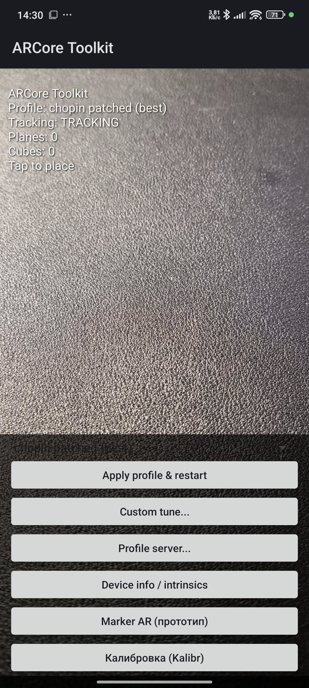
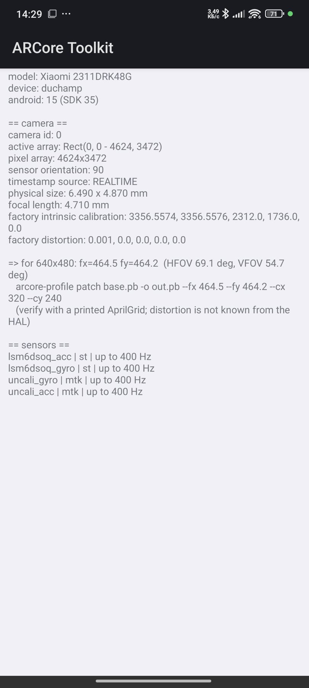

# ARCore Toolkit

Run Google ARCore on Android phones that Google does not support. ARCore
refuses to start without a per-device calibration profile, so this toolkit
helps you install one, test that AR actually works, and — if the phone still
cannot track — replace tracking with a printed AprilTag marker. Everything was
built by reverse engineering ARCore 1.57 on a POCO X6 Pro and a Huawei P30
Lite, without root.

**This is a reverse-engineering research tool, not a polished product.** It
works on the devices it was tested on and may need tweaking on yours. No
Google binaries or profile data are distributed here.

## Quick start

1. **Install the app.** Open the
   [Actions tab](https://github.com/KotPasztet/arcore-toolkit/actions),
   click the latest run with a green check, scroll to the **Artifacts**
   section, download `arcore-toolkit-debug-…`, unzip it and install the APK
   on your phone (Android 10 or newer). Detailed steps:
   [docs/01-getting-started.md](docs/01-getting-started.md).
2. **Apply a device profile.** Open the app, tap **Profiles…**, then
   **Auto: match this camera**. The app picks the closest calibration profile
   on the profile server and rebuilds it for your camera. This needs the
   server to be reachable — the app ships with a default one
   (`https://nikonekt.ru:9444/arcore/switch/`), and you can run your own
   ([docs/04-profiles.md](docs/04-profiles.md)).
3. **Print the tag.** Tap **Print the tag (PDF)** — the app saves a
   print-at-100% A4 PDF (AprilTag, 150 mm black square, 100 mm scale bar) to
   Downloads. Print it, glue it to something rigid, and open **Marker AR** to
   see your phone track it. Details:
   [docs/02-marker-tracking.md](docs/02-marker-tracking.md).

That is the whole path: no JDK, no Android SDK, no Python. Building from
source is also simple (JDK 17 + Android SDK, then `./gradlew :android:assembleDebug`),
but you only need it to change the app itself — CI already builds the same
APK on every push.

## Documentation

| Doc | Content |
|---|---|
| [docs/01-getting-started.md](docs/01-getting-started.md) | install the APK from CI artifacts, first run, profiles |
| [docs/02-marker-tracking.md](docs/02-marker-tracking.md) | print the tag, measure it, track it in the app |
| [docs/03-troubleshooting.md](docs/03-troubleshooting.md) | logs, ADB, common failures |
| [docs/04-profiles.md](docs/04-profiles.md) | what a profile is, the profile server, auto-match and tuning |
| [docs/05-calibration.md](docs/05-calibration.md) *(advanced)* | measure real camera and IMU numbers with Kalibr |
| [docs/06-shim.md](docs/06-shim.md) *(advanced)* | swap ARCore tracking for AprilTag poses in any app |
| [docs/reverse-engineering.md](docs/reverse-engineering.md) *(history)* | the research log this toolkit grew from |

## Screenshots

| AR test | Profiles | Device info / intrinsics |
|---|---|---|
|  |  |  |

## Repository map

| Path | What it is |
|---|---|
| `android/` | the Android test app (Gradle module `:android`) |
| `arcore_profile/` | Python package: profile format, key obfuscation, TOC, ZIP |
| `tools/server/` | profile switch server (no dependencies) |
| `tools/calib/` | calibration tools and printable target generators |
| `tools/shim/` | ARCore C API shim (sources + build scripts) |
| `third_party/apriltag/` | vendored AprilTag 3 (BSD-2-Clause) |
| `tests/` | pytest suite for the profile tools |

## Requirements

* Using the app: an Android 10+ phone. Nothing to install on a PC; ADB is
  only needed for calibration export and bug reports.
* Python tools: Python 3.9+. Building the app: JDK 17 + Android SDK — or let
  CI build it ([docs/01-getting-started.md](docs/01-getting-started.md)).

## License

MIT for this repository; AprilTag is BSD-2-Clause
(`third_party/apriltag/LICENSE.md`). ARCore remains Google's proprietary
software and is not included.
