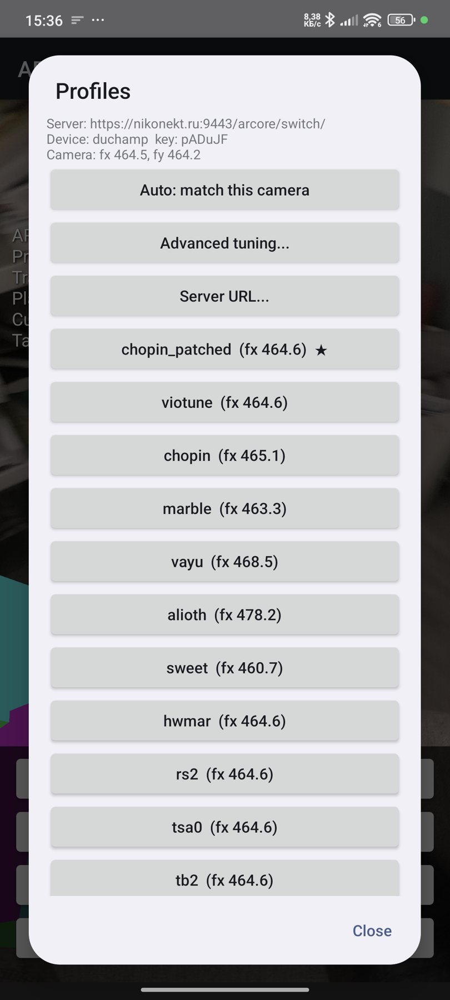

# ARCore Toolkit

Tools for **running ARCore on devices Google does not officially support**, for
managing ARCore *device profiles*, testing AR sessions, calibrating the camera
and IMU, and experimenting with marker-based AR.

The toolkit was built while bringing up ARCore on a POCO X6 Pro (`duchamp`) and a
Huawei P30 Lite (`HWMAR`) without root.  Everything here is the result of
reverse engineering ARCore 1.5x; nothing is documented by Google.

> Personal research on your own devices.  No Google binaries, extracted device
> profiles or modified commercial APKs are distributed here — only tools and
> first-party code.

## Features

| Area | What you get |
|---|---|
| **Device profiles** | derive the profile key (`md5`/base64url of `ro.product.device`), decode/encode profiles, patch intrinsics/IMU/timestamps, build the ZIP ARCore downloads, extract a profile from your own ARCore APK |
| **Profile server** | tiny HTTP server that builds profile ZIPs on the fly (named profiles, per-device keys, custom intrinsics from query parameters) |
| **Test app** | ARCore availability/session test, live HUD, plane/anchor test, **profile browser with auto-match by camera intrinsics**, custom tuning, device info screen, marker-AR prototype, camera+IMU recorder, recovery from an incompatible profile |
| **Calibration** | Camera2 + IMU recorder → ROS bag → Kalibr; OpenCV camera calibration; printable AprilGrid and AprilTag targets |
| **ARCore shim** | replaces `libarcore_sdk_c.so` inside any ARCore app: forward everything to the real library, optionally override tracking with AprilTag poses (marker AR) |
| **Docs** | how the profile format works, how to install profiles without root, per-device case studies, troubleshooting |

## Screenshots

| AR test | Profiles | Device info / intrinsics |
|---|---|---|
|  |  |  |

## Repository layout

```
arcore-toolkit/
├── arcore_profile/       Python package: profile format, obfuscation, TOC, ZIP
├── tools/
│   ├── server/           profile switch server (no dependencies)
│   ├── calib/            calibration + target generators
│   └── shim/             ARCore C API shim (sources + build scripts)
├── android/              test/tool app (builds without Gradle)
├── third_party/apriltag/ vendored AprilTag 3 (BSD-2-Clause)
├── tests/                pytest suite for the profile tools
└── docs/                 user and reverse-engineering docs
```

## Quick start

### 1. Profile tools

```bash
python3 -m venv .venv && . .venv/bin/activate
pip install -e .
pytest

arcore-profile key duchamp
# duchamp   pADuJF

arcore-profile inspect my_profile.pb
# cameras: 0, 1
# camera[0]:
#   fx  = 464.56
#   ...

arcore-profile patch base.pb -o out.pb --fx 410.8 --fy 410.8 --cx 320 --cy 240
arcore-profile zip out.pb -o out.zip --device HWMAR
```

### 2. Profile server

```bash
cp profiles.json.example profiles.json
# put your .pb files into ./profiles/ and edit the glob patterns

python3 tools/server/switch_server.py --profiles-dir profiles --config profiles.json
# profile switch server on http://127.0.0.1:8099
```

Put it behind HTTPS and point ARCore at it:

```bash
adb shell am start -n com.google.ar.core/com.google.ar.core.services.profiles.ProfileDownloadActivity \
  --es explicit-download-url "https://example.com/arcore/switch/mydevice/1.57.262640283.zip"
```

The URL must end with `major.minor.patch` and return `Content-Type:
application/zip`.  See [docs/02-profiles.md](docs/02-profiles.md).

### 3. Test app

```bash
cd android
./build.sh                     # downloads ARCore+OpenCV AARs, signs with a debug key
adb install -r arcore-toolkit.apk
adb shell monkey -p io.github.nikonektik.arcoretoolkit -c android.intent.category.LAUNCHER 1
```

The app has an **ARCore test** screen (session state, planes, anchors, profile
switcher and custom tuning), a **Device info / intrinsics** screen that computes
the fx/fy ARCore expects from the camera characteristics, a **marker AR**
prototype and a **Calibration** recorder.

### 4. ARCore shim (optional, advanced)

```bash
cd tools/shim
./extract-real-lib.sh ../../android/deps/arcore-1.57.0.aar   # real lib + SONAME
./build.sh                                                   # marker override shim
SOURCE_APK=/path/to/app.apk REAL_LIB=libarcore_sdk_c_real.so OUT_APK=app-shim.apk \
  ./package_apk.sh
```

`SHIM_INC=passthrough.inc SHIM_NO_OVERRIDES=1 OUT=libarcore_sdk_c_stock.so ./build.sh`
builds a pure pass-through shim (useful when the device's own ARCore tracking
works but the app ships an old/broken ARCore SDK library).

### 5. Calibration

```bash
pip install -r tools/calib/requirements.txt
python3 tools/calib/make_aprilgrid.py        # printable A4 AprilGrid
# record a session in the app, pull it:
adb exec-out run-as io.github.nikonektik.arcoretoolkit tar -c files/calib > calib.tar
tar -xf calib.tar
python3 tools/calib/calib_to_bag.py files/calib/<session> -o session.bag
# then run Kalibr (see docs/04-calibration.md)
```

## Requirements

* Python 3.9+ (tools), `pytest` for tests.
* JDK 11+, Android SDK (`build-tools`, `platform-35`), Android NDK r25+ for the
  app and the shim.
* A device with ADB access.  Root is **not** required anywhere.

## How it works (short version)

* ARCore ships a database of per-device calibration profiles.  A device that is
  absent from the database is reported as unsupported.  The key is
  `base64url(md5(salt || ro.product.device))[:6]`.
* ARCore can **download** a profile database at runtime through an exported
  activity, so a profile can be installed on a locked device.
* The profile contains camera intrinsics, distortion, rolling-shutter and
  timestamp parameters, camera↔IMU extrinsics and IMU calibration.  Wrong
  intrinsics → wrong scale of planes/anchors; wrong timestamps → unstable VIO.
* For devices whose VIO is unusable even with a good profile, the shim can
  replace tracking with AprilTag marker poses.

## Documentation

| Doc | Content |
|---|---|
| [docs/01-getting-started.md](docs/01-getting-started.md) | install, ADB, first run |
| [docs/02-profiles.md](docs/02-profiles.md) | profile format, obfuscation, no-root install, CLI, server |
| [docs/03-test-app.md](docs/03-test-app.md) | app screens, device info, tuning |
| [docs/04-calibration.md](docs/04-calibration.md) | Kalibr pipeline, targets, results |
| [docs/05-marker-ar.md](docs/05-marker-ar.md) | AprilTag markers, tag size, prototype |
| [docs/06-shim.md](docs/06-shim.md) | shim architecture, coordinate frames, overrides, bugs |
| [docs/07-troubleshooting.md](docs/07-troubleshooting.md) | logs, ADB, ANR, dark-screen crash |
| [docs/devices.md](docs/devices.md) | case studies: POCO X6 Pro, Huawei P30 Lite |
| [docs/reverse-engineering.md](docs/reverse-engineering.md) | how the profile database and key obfuscation were reverse engineered |

## License

MIT for this repository; AprilTag is BSD-2-Clause (see
`third_party/apriltag/LICENSE.md`).  ARCore itself remains Google's proprietary
software and is not included.
