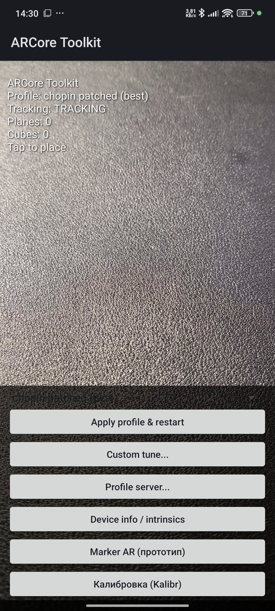
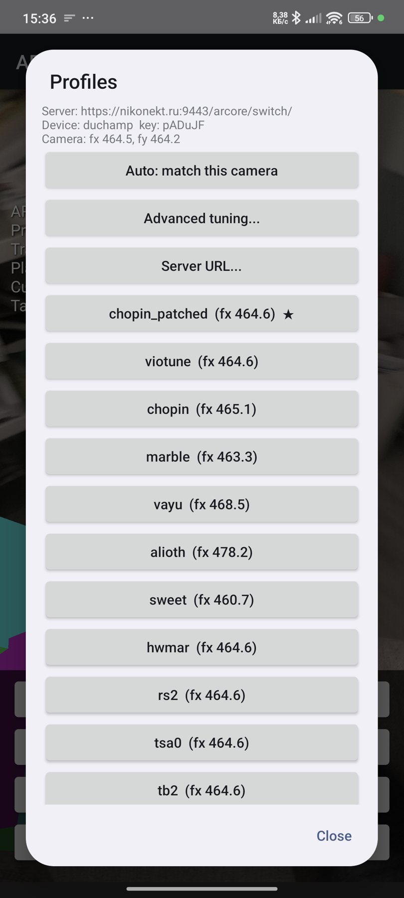
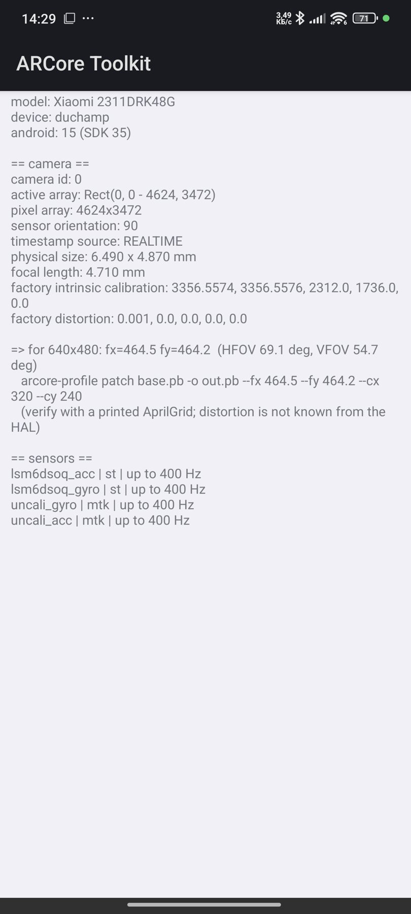

[English](README.md) | **Русский**

# ARCore Toolkit

Инструменты для **запуска ARCore на устройствах, которые Google официально не
поддерживает**, для работы с *профилями устройств* ARCore, тестирования AR-сессий,
калибровки камеры и IMU и экспериментов с маркерным AR.

Тулкит вырос из задачи «завести ARCore на POCO X6 Pro (`duchamp`) и Huawei P30 Lite
(`HWMAR`) без root». Всё здесь — результат реверс-инжиниринга ARCore 1.5x; Google
этого не документирует.

> Личное исследование на собственных устройствах. Бинарники Google, извлечённые
> профили и модифицированные коммерческие APK здесь не распространяются — только
> инструменты и собственный код.

## Возможности

| Область | Что есть |
|---|---|
| **Профили** | вычисление ключа устройства (`md5`/base64url от `ro.product.device`), разбор и правка профилей, интринсики/IMU/таймстемпы, сборка ZIP для загрузки ARCore, извлечение профиля из своего ARCore APK |
| **Сервер профилей** | маленький HTTP-сервер, собирающий ZIP на лету (именованные профили, ключи под устройство, произвольные интринсики через query-параметры) |
| **Тестовое приложение** | проверка availability/сессии, HUD, плоскости и якоря, браузер профилей с авто-подбором по камере, ручной тюнинг, экран характеристик устройства, маркерный AR, запись для калибровки, восстановление после несовместимого профиля, опциональная загрузка ARCore APK с проверкой подписи Google |
| **Калибровка** | запись Camera2 + IMU → ROS bag → Kalibr; калибровка камеры в OpenCV; печатные мишени AprilGrid и AprilTag |
| **Шим ARCore** | подмена `libarcore_sdk_c.so` внутри любого ARCore-приложения: форвардинг в настоящую библиотеку и, опционально, маркерный трекинг на AprilTag |
| **Документация** | формат профилей, установка без root, кейсы устройств, диагностика |

## Скриншоты

| AR-тест | Профили | Характеристики |
|---|---|---|
|  |  |  |

## Структура репозитория

```
arcore-toolkit/
├── arcore_profile/       Python-пакет: формат профиля, обфускация, TOC, ZIP
├── tools/
│   ├── server/           сервер профилей (без зависимостей)
│   ├── calib/            калибровка + генераторы мишеней
│   └── shim/             шим ARCore C API (исходники + сборка)
├── android/              приложение (собирается без Gradle)
├── third_party/apriltag/ AprilTag 3 (BSD-2-Clause, вендорен)
├── tests/                pytest для инструментов профилей
└── docs/                 документация (English) + docs/ru (русский)
```

## Быстрый старт

### 1. Инструменты профилей

```bash
python3 -m venv .venv && . .venv/bin/activate
pip install -e .
pytest

arcore-profile key duchamp
# duchamp   pADuJF

arcore-profile inspect my_profile.pb
# cameras: 0, 1
# camera[0]:
#   fx  = 464.56
#   ...

arcore-profile patch base.pb -o out.pb --fx 410.8 --fy 410.8 --cx 320 --cy 240
arcore-profile zip out.pb -o out.zip --device HWMAR
```

### 2. Сервер профилей

```bash
cp profiles.json.example profiles.json
# положите .pb в ./profiles/ и поправьте glob-шаблоны

python3 tools/server/switch_server.py --profiles-dir profiles --config profiles.json
# profile switch server on http://127.0.0.1:8099
```

Поставьте его за HTTPS и отправьте ARCore:

```bash
adb shell am start -n com.google.ar.core/com.google.ar.core.services.profiles.ProfileDownloadActivity \
  --es explicit-download-url "https://example.com/arcore/switch/mydevice/1.57.262640283.zip"
```

URL должен заканчиваться на `major.minor.patch` и отдавать
`Content-Type: application/zip`. Подробнее — [docs/ru/02-profiles.md](docs/ru/02-profiles.md).

### 3. Тестовое приложение

```bash
cd android
./build.sh                     # скачает ARCore+OpenCV AAR, подпишет debug-ключом
adb install -r arcore-toolkit.apk
adb shell monkey -p io.github.nikonektik.arcoretoolkit -c android.intent.category.LAUNCHER 1
```

В приложении: AR-тест (состояние сессии, плоскости, якоря, браузер профилей),
**Device info / intrinsics** (считает `fx/fy` из характеристик камеры),
маркерный AR и запись для калибровки.

### 4. Шим ARCore (опционально)

```bash
cd tools/shim
./extract-real-lib.sh ../../android/deps/arcore-1.57.0.aar   # настоящая библиотека + SONAME
# одной командой: собрать шим, пропатчить APK, установить
python3 tools/shim/patch_apk.py /path/to/app.apk --build-shim --install

# или вручную
cd tools/shim
./build.sh                                                   # маркерный шим
SOURCE_APK=/path/to/app.apk REAL_LIB=libarcore_sdk_c_real.so OUT_APK=app-shim.apk \
  ./package_apk.sh
```

`SHIM_INC=passthrough.inc SHIM_NO_OVERRIDES=1 OUT=libarcore_sdk_c_stock.so ./build.sh` —
чистый passthrough (полезно, когда родной трекинг работает, а приложение везёт старую
SDK-библиотеку).

### 5. Калибровка

```bash
pip install -r tools/calib/requirements.txt
python3 tools/calib/make_aprilgrid.py        # печатная мишень A4
# запишите сессию в приложении и вытащите её:
adb exec-out run-as io.github.nikonektik.arcoretoolkit tar -c files/calib > calib.tar
tar -xf calib.tar
python3 tools/calib/calib_to_bag.py files/calib/<session> -o session.bag
# затем Kalibr (см. docs/ru/04-calibration.md)
```

## Требования

* Python 3.9+ (инструменты), `pytest` для тестов.
* JDK 11+, Android SDK (`build-tools`, `platform-35`), Android NDK r25+ для
  приложения и шима.
* Устройство с ADB. Root **не нужен**.

## Как это работает (кратко)

* ARCore поставляется с базой профилей калибровки. Устройство, которого нет в базе,
  считается неподдерживаемым. Ключ —
  `base64url(md5(salt || ro.product.device))[:6]`.
* ARCore умеет **скачивать** базу профилей в рантайме через экспортированную
  activity — так профиль ставится на заблокированное устройство.
* В профиле: интринсики и дисторсия камеры, rolling shutter и таймстемпы,
  экстринсики камера↔IMU и калибровка IMU. Неверные интринсики → неверный масштаб
  плоскостей; неверные таймстемпы → нестабильный VIO.
* Если VIO непригоден даже с хорошим профилем, шим подменяет трекинг позой
  AprilTag-маркера.

## Документация

**Русская версия (полная):**

| Документ | Содержание |
|---|---|
| [docs/ru/01-getting-started.md](docs/ru/01-getting-started.md) | установка, ADB, первый запуск |
| [docs/ru/02-profiles.md](docs/ru/02-profiles.md) | формат профилей, обфускация, установка без root, CLI, сервер |
| [docs/ru/03-test-app.md](docs/ru/03-test-app.md) | экраны приложения, профили, тюнинг, восстановление |
| [docs/ru/04-calibration.md](docs/ru/04-calibration.md) | конвейер Kalibr, мишени, результаты |
| [docs/ru/05-marker-ar.md](docs/ru/05-marker-ar.md) | маркеры AprilTag, размер, прототип |
| [docs/ru/06-shim.md](docs/ru/06-shim.md) | архитектура шима, системы координат, оверрайды |
| [docs/ru/07-troubleshooting.md](docs/ru/07-troubleshooting.md) | логи, ANR, чёрный экран, восстановление профиля |
| [docs/ru/devices.md](docs/ru/devices.md) | кейсы: POCO X6 Pro, Huawei P30 Lite |
| [docs/ru/reverse-engineering.md](docs/ru/reverse-engineering.md) | как реверсили базу профилей и обфускацию ключа |

**English:** [README.md](README.md) и [docs/](docs/).

## Релизы

Релизы теперь ручные. После проверки сборки/трекинга на устройстве запусти
workflow **release** во вкладке GitHub Actions. Он создаст тег
`v<версия>-build.<номер>` и GitHub Release с APK (все ABI), маркерным/passthrough
шимом и Python wheel/sdist. Для стабильной подписи между релизами задайте секреты
`ANDROID_KEYSTORE_BASE64`, `ANDROID_KEYSTORE_PASSWORD`, `ANDROID_KEY_ALIAS`,
`ANDROID_KEY_PASSWORD`; иначе CI подписывает одноразовым debug-ключом.

## Лицензия

MIT для этого репозитория; AprilTag — BSD-2-Clause (см.
`third_party/apriltag/LICENSE.md`). Сам ARCore остаётся проприетарным ПО Google и
здесь не распространяется.
